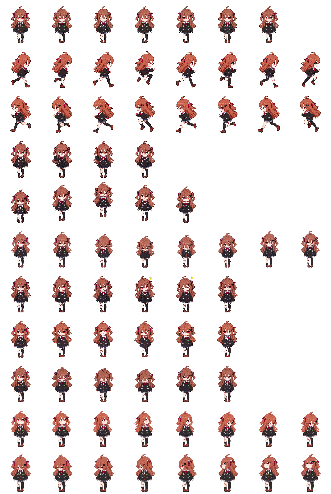

# Evil Neuro · Codex Mini 像素桌宠

[English](README.en.md) · [快速安装](#快速安装) · [动作与预览](#动作与预览) · [版权声明](COPYRIGHT.md)

把 Evil Neuro 带到你的 Codex Mini 桌面！像素 Q 版造型保留了她的栗红长发、红眼、黑色破碎心形发夹、不对称长短袜和右膝创可贴。她会眨眼、奔跑、挥手和跳跃；等待回应时，向画面左侧歪头，头部右侧出现一个黄色问号；工作中站着思考，检查成果时点头确认。

当前成品版本为 **V1.1 / v1.1.0**，包含 **9 组标准动作、57 个标准动作帧和 16 个注视方向**，采用透明背景和 **Codex 图集格式 v2**。本版增强了失败动作的低头失落与恢复、点头动作的下点与回正，并修订注视表现。

宠物显示名：**Evil Neuro**。介绍：**Evil Neuro Model Pixel Character**。

制作与分享：**[Axenor](https://github.com/Axenor)**。

## 动态预览

<table>
  <tr>
    <td align="center" width="33%"><br><b>待机 · 呼吸与眨眼</b></td>
    <td align="center" width="33%"><br><b>等待 · 歪头与问号</b></td>
    <td align="center" width="33%"><br><b>检查成果 · 点头确认</b></td>
  </tr>
</table>

GIF 为循环展示预览；实际动作触发与播放速度由客户端控制。`running` 表示任务工作中。

## 动作与预览

| 状态 | 帧数 | 表现与动态预览 |
| --- | ---: | --- |
| `idle` | 6 | [呼吸与眨眼](previews/idle.gif) |
| `running-right` | 8 | [向画面右侧奔跑](previews/running-right.gif) |
| `running-left` | 8 | [向画面左侧奔跑](previews/running-left.gif) |
| `waving` | 4 | [挥手](previews/waving.gif) |
| `jumping` | 5 | [轻轻跳起与落下](previews/jumping.gif) |
| `failed` | 8 | [低头失落，再恢复站姿](previews/failed.gif) |
| `waiting` | 6 | [左歪头，右侧出现黄色问号](previews/waiting.gif) |
| `running` | 6 | [站姿思考](previews/running.gif) |
| `review` | 6 | [点头与回正确认](previews/review.gif) |
| 注视方向 | 16 | [顺时针方向预览](previews/look-directions.gif) |

小尺寸下，胸前细饰与膝贴较细小，部分斜向注视的变化较细微，可结合目光、头部转向和仰俯观察。GIF 调色板转换可能带来细微色差。

<details>
<summary>查看完整透明图集</summary>



1536 × 2288 像素，8 × 11 格，每格 192 × 208。第 0–8 行是九组标准动作，第 9–10 行是十六个注视方向。

</details>

## 快速安装

### Agent 安装

将下列提示词交给具有网络访问和本机文件权限的 Agent：

```text
请在这台电脑上安装 GitHub 仓库 https://github.com/Axenor/Evil-Neuro-codex-pet 的 Codex 原生 v2 桌宠“Evil Neuro”。
1. 识别操作系统，并确认当前桌面应用支持本地自定义 v2 宠物。
2. 下载并解压 https://github.com/Axenor/Evil-Neuro-codex-pet/releases/download/v1.1.0/evil-neuro-v1.1.0.zip。若下载失败，说明原因，并询问我是否改为从仓库获取安装文件及 SHA256SUMS.txt。
3. 解压后的两个安装文件位于 output/evil-neuro/pet.json 和 output/evil-neuro/spritesheet.webp；校验清单 SHA256SUMS.txt 位于包根目录。
4. 使用应用实际配置的 CODEX_HOME；未设置时使用用户主目录下的 .codex。安装目标为其下的 pets/evil-neuro/。
5. 写入前核对 id=evil-neuro、displayName=Evil Neuro、spriteVersionNumber=2、spritesheetPath=spritesheet.webp，并根据 SHA256SUMS.txt 校验两个安装文件。
6. 若目标目录已存在，停止并询问如何处理现有版本。不要覆盖、删除或修改其他宠物。
7. 只将 pet.json 与 spritesheet.webp 复制到同一个 evil-neuro 目录，不要多套一层目录，也不要复制预览或整个仓库。
8. 告诉我实际安装路径及检查结果，提醒我在设置的 Mini 与虚拟宠物列表中选择 Evil Neuro；未出现时重新打开应用再检查。
9. 不要为了安装修改图集尺寸、版本、角色素材或其他应用设置。
```

### 下载 Release 安装包

下载 [evil-neuro-v1.1.0.zip](https://github.com/Axenor/Evil-Neuro-codex-pet/releases/download/v1.1.0/evil-neuro-v1.1.0.zip) 后解压。在解压后的包根目录运行安装辅助脚本：

**Windows / PowerShell：**

```powershell
powershell -NoProfile -ExecutionPolicy Bypass -File .\scripts\install.ps1
```

**macOS / 终端：**

```bash
bash scripts/install.sh
```

安装脚本先校验两个安装文件的 SHA256、宠物 ID 与图集格式，再复制文件。同名目标目录已存在时会停止，请先保存并处理已有版本。

### 从仓库克隆安装

**Windows / PowerShell：**

```powershell
git clone https://github.com/Axenor/Evil-Neuro-codex-pet.git
Set-Location .\Evil-Neuro-codex-pet
powershell -NoProfile -ExecutionPolicy Bypass -File .\scripts\install.ps1
```

**macOS / 终端：**

```bash
git clone https://github.com/Axenor/Evil-Neuro-codex-pet.git
cd Evil-Neuro-codex-pet
bash scripts/install.sh
```

脚本默认读取环境变量 `CODEX_HOME`；未设置时使用用户主目录下的 `.codex`。如果应用使用另一目录，可显式指定；此参数优先于环境变量：

```powershell
powershell -NoProfile -ExecutionPolicy Bypass -File .\scripts\install.ps1 -CodexHome 'D:\your-codex-home'
```

```bash
bash scripts/install.sh --codex-home "/path/to/codex-home"
```

### 手动复制安装

1. 从解压包或仓库的 `output/evil-neuro/` 取得 `pet.json` 和 `spritesheet.webp`。用根目录的 `SHA256SUMS.txt` 核对两文件的 SHA256；Windows 可用 `Get-FileHash`，macOS 可在包根目录运行 `shasum -a 256 -c SHA256SUMS.txt` 检查完整包。
2. 打开应用实际使用的 Codex 用户目录。默认情况下，Windows 在资源管理器地址栏输入 `%USERPROFILE%\.codex\pets\`；macOS 在 Finder 按 `⌘ ⇧ G` 输入 `~/.codex/pets/`。
3. 新建 `evil-neuro` 文件夹，将两个文件放入其中。若同名目录已存在，先保留并处理旧版。

最终目录应为：

```text
<CODEX_HOME 或用户主目录下的 .codex>/pets/evil-neuro/
├── pet.json
└── spritesheet.webp
```

### 完成安装

在 Codex 的 **设置 → Mini 与虚拟宠物** 中选择 **Evil Neuro**。菜单名称可能随客户端语言和版本变化；列表未更新时，重新打开应用再检查。

如果宠物未出现，检查两个安装文件是否位于同一文件夹、文件名是否正确、`CODEX_HOME` 是否与当前应用一致，以及客户端是否支持 v2。预览 GIF 无需复制到安装目录。

## 文件结构

```text
Evil-Neuro-codex-pet/
├── README.md / README.en.md   # 中英文介绍与安装说明
├── COPYRIGHT.md              # 版权声明
├── CHANGELOG.md              # 版本更新记录
├── VERSION.json              # 成品版本与图集规格
├── SHA256SUMS.txt            # 其余 22 个文件的 SHA256
├── output/evil-neuro/        # pet.json 与 spritesheet.webp
├── previews/                # 十个 GIF 预览和一张待机 PNG
├── scripts/                 # Windows 与 macOS 安装辅助脚本
├── .gitattributes
└── .gitignore
```

## Tips

如果你觉得人物太小了，可在 设置 → Mini 与虚拟宠物 → 自定义 → 宠物大小 调整，最大支持默认尺寸的 2 倍。

## 制作与版权

制作与分享：**[Axenor](https://github.com/Axenor)**。本像素宠物由提供的角色参考图经 AI 辅助制作、动画整理和局部修订完成。

本项目是 Evil Neuro 的同人衍生作品。原角色、设计及相关知识产权归相应权利人所有；本仓库不授予底层角色 IP 的许可证。完整声明见 [COPYRIGHT.md](COPYRIGHT.md)。
